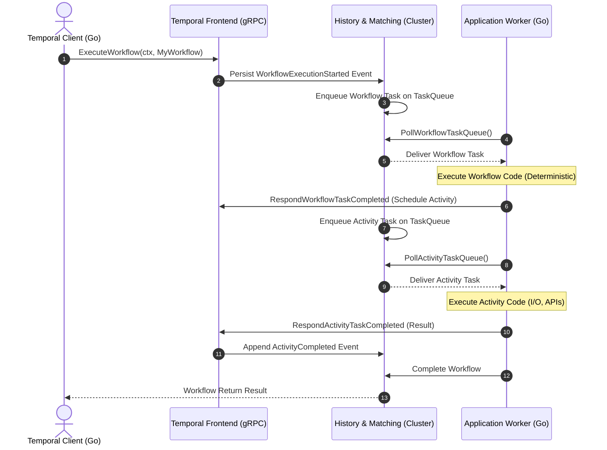
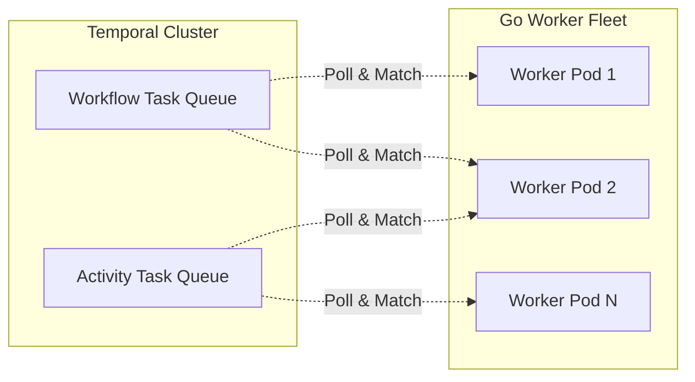
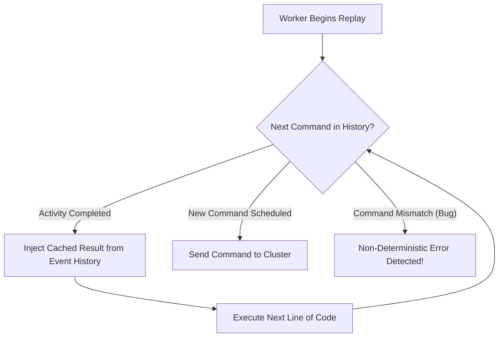
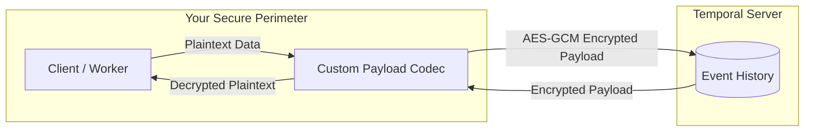

# Complete Temporal Go SDK Handbook & Architectural Reference

[](https://pkg.go.dev/go.temporal.io/sdk)
[](https://opensource.org/licenses/MIT)
[](https://docs.temporal.io)
[](https://github.com/rishabh625)

> An in-depth, production-ready handbook and cheat sheet for building resilient, event-driven, distributed applications using the **Temporal Platform** and the **Temporal Go SDK** (`go.temporal.io/sdk`).

---

<details>
<summary><strong>⚡ Quick Reference / TL;DR Cheat Sheet (Click to expand)</strong></summary>

<br>

| Requirement / Scenario | Temporal Primitive | Go SDK Implementation / API |
|:---|:---|:---|
| **Non-deterministic / I/O work** | Activity | `workflow.ExecuteActivity(ctx, ActivityFunc, args)` |
| **Durable sleep / delay** | Workflow Timer | `workflow.Sleep(ctx, duration)` |
| **Inspect running state (read-only)** | Query | `workflow.SetQueryHandler(ctx, "queryName", handler)` |
| **Asynchronous state update** | Signal | `workflow.GetSignalChannel(ctx, "signalName")` |
| **Signal a workflow that may not exist** | Signal-With-Start | `client.SignalWithStartWorkflow(ctx, id, signal, ...)` |
| **Long-running loop (prevent history explosion)** | Continue-As-New | `workflow.NewContinueAsNewError(ctx, WorkflowFunc, ...)` |
| **Detect stuck long-running activity** | Heartbeat | `activity.RecordHeartbeat(ctx, progress)` |
| **Graceful workflow shutdown** | Cancellation | `workflow.GetVersion(ctx, ...)` & context cancellation |
| **Filter & search workflows** | Search Attributes | List Filter: `WorkflowType = "Order" AND Status = "Running"` |
| **Data encryption & privacy** | Custom Payload Codec | Implement `converter.PayloadCodec` |

</details>

---

<details>
<summary><strong>📖 Table of Contents (Click to expand)</strong></summary>

<br>

- [1. Temporal Platform Architecture](#1-temporal-platform-architecture)
  - [Core Components](#core-components)
  - [System Flow Diagram](#system-flow-diagram)
- [2. Core Concepts: Workflows vs Activities](#2-core-concepts-workflows-vs-activities)
  - [Workflows: Durable Execution](#workflows-durable-execution)
  - [Activities: Side Effects \& I/O](#activities-side-effects--io)
  - [Workflows vs Activities Comparison Matrix](#workflows-vs-activities-comparison-matrix)
- [3. Workers and Task Queues](#3-workers-and-task-queues)
  - [Worker Architecture](#worker-architecture)
  - [Task Queue Polling Mechanics](#task-queue-polling-mechanics)
  - [High Availability Recommendations](#high-availability-recommendations)
- [4. Go SDK Implementation Patterns](#4-go-sdk-implementation-patterns)
  - [Initializing the Client](#initializing-the-client)
  - [Defining and Registering Activities](#defining-and-registering-activities)
  - [Defining and Registering Workflows](#defining-and-registering-workflows)
  - [Worker Bootstrap](#worker-bootstrap)
  - [Triggering a Workflow Execution](#triggering-a-workflow-execution)
- [5. Workflow Determinism & Replay Mechanics](#5-workflow-determinism--replay-mechanics)
  - [How Event Replay Works](#how-event-replay-works)
  - [The Determinism Matrix: Forbidden vs Safe Go Primitives](#the-determinism-matrix-forbidden-vs-safe-go-primitives)
  - [Static Analysis with workflowcheck](#static-analysis-with-workflowcheck)
  - [Workflow Versioning (workflow.GetVersion)](#workflow-versioning-workflowgetversion)
- [6. Interacting with Running Workflows](#6-interacting-with-running-workflows)
  - [Signals (Asynchronous State Mutation)](#signals-asynchronous-state-mutation)
  - [Queries (Synchronous State Inspection)](#queries-synchronous-state-inspection)
  - [Signal-With-Start](#signal-with-start)
  - [Limits and Constraints](#limits-and-constraints)
- [7. Timeouts, Heartbeats, and Cancellation](#7-timeouts-heartbeats-and-cancellation)
  - [Activity Timeout Dimensions](#activity-timeout-dimensions)
  - [Activity Heartbeating](#activity-heartbeating)
  - [Cancellation vs Termination](#cancellation-vs-termination)
- [8. Error Handling & Retry Policies](#8-error-handling--retry-policies)
  - [Default Retry Policy Mechanics](#default-retry-policy-mechanics)
  - [Non-Retryable Application Errors](#non-retryable-application-errors)
- [9. Event History, Size Limits & Continue-As-New](#9-event-history-size-limits--continue-as-new)
  - [Event History Thresholds](#event-history-thresholds)
  - [Implementing Continue-As-New](#implementing-continue-as-new)
- [10. Sticky Execution & Performance Optimization](#10-sticky-execution--performance-optimization)
- [11. Visibility & Advanced Search Attributes](#11-visibility--advanced-search-attributes)
  - [List Filter Syntax](#list-filter-syntax)
  - [Custom Search Attributes](#custom-search-attributes)
- [12. Payload Security: Codecs & Encryption](#12-payload-security-codecs--encryption)
  - [End-to-End Encryption Flow](#end-to-end-encryption-flow)
  - [Remote Codec Server Integration](#remote-codec-server-integration)
- [13. Cluster Services Internals](#13-cluster-services-internals)
- [14. Polyglot Microservices Orchestration](#14-polyglot-microservices-orchestration)
- [15. Production Troubleshooting & Debugging Checklist](#15-production-troubleshooting--debugging-checklist)
- [16. Frequently Asked Questions (FAQ)](#16-frequently-asked-questions-faq)

</details>

---

## 1. Temporal Platform Architecture

Temporal is a distributed, scalable, durable, and highly available orchestration engine. It abstracts away failure recovery, distributed timers, and state persistence so developers can write complex asynchronous workflows as procedural code.

### Core Components

1. **Temporal Client**: The application layer entry point that triggers, signals, and queries workflows over gRPC.
2. **Temporal Frontend Service**: The stateless API gateway that validates requests, handles rate-limiting, and routes calls.
3. **History Service**: Maintains execution state, appends events to the immutable Event History, and coordinates workflow timers.
4. **Matching Service**: Hosts Task Queues and matches queued workflow/activity tasks to polling workers.
5. **Worker Service**: Internal Temporal cluster background workers executing system-level maintenance workflows.
6. **Application Workers**: User-managed Go processes that poll Task Queues and execute your application's Workflow and Activity definitions.

### System Flow Diagram



---

## 2. Core Concepts: Workflows vs Activities

### Workflows: Durable Execution

A **Workflow Definition** is an orchestration function written in Go. Its execution state is saved to the cluster at every step. If the host machine dies, a container restarts, or the network partitions, Temporal recovers the execution state on another worker by replaying its Event History.

> [!IMPORTANT]
> **Workflow Golden Rule**: Workflow code must be purely deterministic. No direct disk I/O, no network calls, no random numbers, and no standard Go concurrency primitives (use `workflow.Go` instead of `go`).

### Activities: Side Effects & I/O

An **Activity Definition** encapsulates non-deterministic operations and side effects:
- Calling third-party APIs (Stripe, Twilio, OpenAI, REST/gRPC endpoints)
- Reading or writing to PostgreSQL, Redis, DynamoDB
- Disk filesystem read/write operations
- Heavy computational tasks

Activities can be retried automatically based on custom exponential backoff policies and independently monitored via heartbeats.

### Workflows vs Activities Comparison Matrix

| Feature | Workflow | Activity |
|:---|:---|:---|
| **Primary Role** | Orchestration & State Coordination | Execution of side effects & I/O |
| **Execution Guarantee** | Purely deterministic replay | Idempotent or non-deterministic execution |
| **Timeouts** | Execution & Run timeouts | Start-To-Close, Schedule-To-Close, Heartbeat |
| **Retries** | Manual or start-configured (Rare) | Exponential backoff retry policies (Default) |
| **Concurrency** | `workflow.Go`, `workflow.Channel` | Goroutines, worker threads, async tasks |
| **Duration** | Minutes to years | Seconds to hours |
| **External Calls** | ❌ Strictly forbidden | ✅ Supported |

---

## 3. Workers and Task Queues

### Worker Architecture

A Temporal Worker is a standalone Go process run by your engineering team. Workers maintain persistent long-polling gRPC connections to the Temporal Cluster.



### Task Queue Polling Mechanics

- Task Queues are **dynamically created** as soon as an activity/workflow schedules a task or a worker polls for work.
- Workers can be partitioned to dedicate specific hardware (e.g., GPU nodes, high-memory instances) to specific Task Queues.
- Backpressure is built-in: if all workers are busy, tasks remain safely queued in Temporal's persistence layer without dropping requests.

### High Availability Recommendations

1. **Minimum 2 Workers per Queue**: Always deploy at least 2 worker replicas across distinct availability zones.
2. **Graceful Shutdown**: Always capture `os.Interrupt` or `syscall.SIGTERM` using `worker.InterruptCh()` to allow currently running activities to drain or heartbeat before exiting.
3. **Resource Tuning**: Adjust `worker.Options.MaxConcurrentActivityExecutionSize` and `MaxConcurrentWorkflowTaskExecutionSize` based on available CPU and RAM.

---

## 4. Go SDK Implementation Patterns

### Initializing the Client

```go
package main

import (
	"log"

	"go.temporal.io/sdk/client"
)

func NewTemporalClient() (client.Client, error) {
	c, err := client.Dial(client.Options{
		HostPort:  client.DefaultHostPort, // "localhost:7233"
		Namespace: client.DefaultNamespace, // "default"
	})
	if err != nil {
		return nil, err
	}
	return c, nil
}
```

### Defining and Registering Activities

Activities accept a standard Go `context.Context` and strongly typed parameters:

```go
package app

import (
	"context"
	"fmt"
	"time"

	"go.temporal.io/sdk/activity"
)

type PaymentInput struct {
	AccountID string  `json:"account_id"`
	Amount    float64 `json:"amount"`
}

type PaymentOutput struct {
	TransactionID string    `json:"transaction_id"`
	Timestamp     time.Time `json:"timestamp"`
}

func ProcessPaymentActivity(ctx context.Context, input PaymentInput) (*PaymentOutput, error) {
	logger := activity.GetLogger(ctx)
	logger.Info("Processing payment", "AccountID", input.AccountID, "Amount", input.Amount)

	// Simulated external API call
	if input.Amount <= 0 {
		return nil, fmt.Errorf("invalid transaction amount: %.2f", input.Amount)
	}

	return &PaymentOutput{
		TransactionID: "txn_9837429837",
		Timestamp:     time.Now().UTC(),
	}, nil
}
```

### Defining and Registering Workflows

Workflows require `workflow.Context` as their first argument:

```go
package app

import (
	"time"

	"go.temporal.io/sdk/temporal"
	"go.temporal.io/sdk/workflow"
)

type OrderWorkflowInput struct {
	OrderID   string       `json:"order_id"`
	Customer  string       `json:"customer"`
	Payment   PaymentInput `json:"payment"`
}

func OrderFulfillmentWorkflow(ctx workflow.Context, input OrderWorkflowInput) (string, error) {
	logger := workflow.GetLogger(ctx)
	logger.Info("Starting OrderFulfillmentWorkflow", "OrderID", input.OrderID)

	// Configure Activity Execution Options
	activityOptions := workflow.ActivityOptions{
		StartToCloseTimeout: 30 * time.Second,
		RetryPolicy: &temporal.RetryPolicy{
			InitialInterval:    time.Second * 1,
			BackoffCoefficient: 2.0,
			MaximumInterval:    time.Minute * 1,
			MaximumAttempts:    5,
		},
	}
	ctx = workflow.WithActivityOptions(ctx, activityOptions)

	// Execute Payment Activity
	var paymentResult PaymentOutput
	err := workflow.ExecuteActivity(ctx, ProcessPaymentActivity, input.Payment).Get(ctx, &paymentResult)
	if err != nil {
		logger.Error("Payment processing failed", "Error", err)
		return "", err
	}

	// Durable Sleep: survives restarts and machine reboots
	logger.Info("Payment confirmed. Waiting 24 hours before follow-up notification...")
	_ = workflow.Sleep(ctx, 24*time.Hour)

	return paymentResult.TransactionID, nil
}
```

### Worker Bootstrap

```go
package main

import (
	"log"

	"go.temporal.io/sdk/client"
	"go.temporal.io/sdk/worker"

	"your_project/app"
)

const TaskQueueName = "ORDER_PROCESSING_TASK_QUEUE"

func main() {
	c, err := client.Dial(client.Options{})
	if err != nil {
		log.Fatalf("Failed to initialize client: %v", err)
	}
	defer c.Close()

	w := worker.New(c, TaskQueueName, worker.Options{})

	// Register workflows & activities
	w.RegisterWorkflow(app.OrderFulfillmentWorkflow)
	w.RegisterActivity(app.ProcessPaymentActivity)

	// Start worker listener (blocks until interrupt signal)
	if err := w.Run(worker.InterruptCh()); err != nil {
		log.Fatalf("Worker exited with error: %v", err)
	}
}
```

### Triggering a Workflow Execution

```go
func StartOrder(c client.Client, orderID string) (client.WorkflowRun, error) {
	options := client.StartWorkflowOptions{
		ID:        "order-" + orderID,
		TaskQueue: TaskQueueName,
		// Reject duplicates if an instance is already running
		WorkflowIDReusePolicy: temporal.WORKFLOW_ID_REUSE_POLICY_REJECT_DUPLICATE,
	}

	input := app.OrderWorkflowInput{
		OrderID:  orderID,
		Customer: "alice@example.com",
		Payment:  app.PaymentInput{AccountID: "acc_101", Amount: 249.99},
	}

	run, err := c.ExecuteWorkflow(context.Background(), options, app.OrderFulfillmentWorkflow, input)
	if err != nil {
		return nil, err
	}

	log.Printf("Started workflow with ID: %s, RunID: %s", run.GetID(), run.GetRunID())
	return run, nil
}
```

---

## 5. Workflow Determinism & Replay Mechanics

### How Event Replay Works

When a worker receives a Workflow Task, it executes the Go workflow code from line 1. When it hits an activity invocation or timer:
1. It looks at the **Event History**.
2. If `ActivityTaskCompleted` or `TimerFired` is present in the history, Temporal returns the recorded result immediately without executing the activity again.
3. This is how Temporal recovers execution state in-memory after worker crashes.



### The Determinism Matrix: Forbidden vs Safe Go Primitives

Writing non-deterministic code in a workflow will cause replay failure:

| Category | ❌ Forbidden in Workflow Code | ✅ Safe Temporal Alternative | Why It Breaks Replay |
|:---|:---|:---|:---|
| **Time** | `time.Now()` | `workflow.Now(ctx)` | System clock advances during replay |
| **Sleeping** | `time.Sleep(10 * time.Second)` | `workflow.Sleep(ctx, 10*time.Second)` | Pauses worker thread; not durable |
| **Concurrency** | `go myGoroutine()` | `workflow.Go(ctx, myFunc)` | Unmanaged goroutines break event tracking |
| **Channels** | `make(chan T)` | `workflow.NewChannel(ctx)` | Native channels break determinism |
| **Map Iteration** | `for k, v := range myMap` | Extract keys into slice, sort, then iterate | Go map iteration order is deliberately randomized |
| **Randomness** | `rand.Intn(100)`, `uuid.New()` | `workflow.SideEffect` or wrap in Activity | Returns different value on every replay |
| **External I/O** | `http.Get()`, `sql.Open()` | Execute inside an Activity | Network results vary across runs |
| **Global State** | Reading/modifying global vars | Keep state inside workflow instance variables | Shared mutable memory introduces race conditions |

### Static Analysis with workflowcheck

Temporal provides an automated linter to catch determinism violations during CI/CD before code merges to production:

```bash
# Install the workflowcheck linter
go install go.temporal.io/sdk/contrib/tools/workflowcheck@latest

# Run analysis against your packages
workflowcheck ./...
```

### Workflow Versioning (`workflow.GetVersion`)

When business logic changes for active workflows, use `workflow.GetVersion` to protect running executions from replay mismatches:

```go
var discount float64
// Identifier: "applyDiscountLogic", minSupported: DefaultVersion (-1), maxSupported: 1
version := workflow.GetVersion(ctx, "applyDiscountLogic", workflow.DefaultVersion, 1)

if version == workflow.DefaultVersion {
    // Legacy logic for executions started prior to version 1
    discount = 0.05
} else {
    // New logic for recent executions
    discount = 0.15
}
```

---

## 6. Interacting with Running Workflows

### Signals (Asynchronous State Mutation)

Signals allow external systems or other workflows to push messages into a running workflow execution.

```go
// Define a Signal Name
const PaymentSignalName = "PaymentReceivedSignal"

type PaymentSignalPayload struct {
    ReceiptNumber string `json:"receipt_number"`
}

// In Workflow code:
signalChan := workflow.GetSignalChannel(ctx, PaymentSignalName)

// Block until signal is received or a timeout expires
selector := workflow.NewSelector(ctx)
selector.AddReceive(signalChan, func(c workflow.ReceiveChannel, more bool) {
    var signal PaymentSignalPayload
    c.Receive(ctx, &signal)
    workflow.GetLogger(ctx).Info("Received payment signal", "Receipt", signal.ReceiptNumber)
})
selector.Select(ctx)
```

Sending a Signal from a Client:

```go
err := client.SignalWorkflow(ctx, workflowID, "", PaymentSignalName, PaymentSignalPayload{
    ReceiptNumber: "rcpt_4982734",
})
```

### Queries (Synchronous State Inspection)

Queries synchronously inspect the in-memory state of a workflow execution without mutating state or appending events to Event History:

```go
const OrderStatusQuery = "GetOrderStatus"

// Register Query Handler inside Workflow code:
var currentStatus = "INITIATED"

err := workflow.SetQueryHandler(ctx, OrderStatusQuery, func() (string, error) {
    return currentStatus, nil
})
```

Querying from a Client:

```go
val, err := client.QueryWorkflow(ctx, workflowID, "", OrderStatusQuery)
if err != nil {
    log.Fatal(err)
}
var status string
_ = val.Get(&status)
fmt.Println("Current Order Status:", status)
```

### Signal-With-Start

Guarantees atomic start-or-signal semantics:
- If the workflow execution with the specified Workflow ID is already running, the Signal is delivered.
- If it does not exist, it starts a new workflow instance and immediately passes the Signal.

```go
run, err := client.SignalWithStartWorkflow(ctx, workflowID, signalName, signalArg, options, WorkflowFunc, workflowArgs)
```

### Limits and Constraints

- **Pending Outgoing Signals**: Maximum 2,000 pending outgoing signal requests per execution.
- **Received Signals Limit**: Recommended maximum 10,000 received signals per single run. Exceeding this requires using **Continue-As-New**.

---

## 7. Timeouts, Heartbeats, and Cancellation

### Activity Timeout Dimensions

Temporal provides 4 distinct timeout options to prevent stuck tasks:

```mermaid
gantt
    title Temporal Activity Timeout Lifecycle
    dateFormat  X
    axisFormat %s sec

    section ScheduleToClose
    Total Allowed Execution Time (Inc. Retries & Queue) :0, 80

    section ScheduleToStart
    Task Waiting in Queue :0, 15

    section StartToClose
    Attempt 1 (Fails) :15, 35
    Attempt 2 (Succeeds) :45, 70

    section HeartbeatTimeout
    Heartbeat Window :15, 25
```



1. **`StartToCloseTimeout`** (*Required if ScheduleToClose is omitted*): Max time allowed for a single activity attempt.
2. **`ScheduleToCloseTimeout`**: Total end-to-end time allowed from initial scheduling through all retries until final completion.
3. **`ScheduleToStartTimeout`**: Max time a task can linger in the Task Queue waiting for an available worker before timing out.
4. **`HeartbeatTimeout`**: Max permissible delay between heartbeats from an activity. Ideal for detecting worker crashes during long-running tasks.

### Activity Heartbeating

For operations longer than a few seconds (file processing, ML inference, database migrations):

```go
func HeavyBatchProcessActivity(ctx context.Context, totalBatches int) error {
    for i := 1; i <= totalBatches; i++ {
        // Perform chunk of work
        processBatch(i)

        // Record Heartbeat with progress payload
        activity.RecordHeartbeat(ctx, i)

        // Check for cancellation signal delivered through heartbeat
        select {
        case <-ctx.Done():
            return ctx.Err()
        default:
        }
    }
    return nil
}
```

### Cancellation vs Termination

- **Cancellation (`client.CancelWorkflow`)**: A graceful stop request. The workflow context is canceled, triggering `<-ctx.Done()`. Workflows can catch this to execute compensation logic (e.g., Saga pattern rollback).
- **Termination (`client.TerminateWorkflow`)**: A hard, immediate kill. The workflow execution stops instantly. Cleanup logic cannot run.

---

## 8. Error Handling & Retry Policies

### Default Retry Policy Mechanics

Activities use an exponential backoff policy by default:

```go
type RetryPolicy struct {
    InitialInterval    time.Duration // Default: 1s
    BackoffCoefficient float64       // Default: 2.0
    MaximumInterval    time.Duration // Default: 100 * InitialInterval
    MaximumAttempts    int32         // Default: 0 (Unlimited)
    NonRetryableErrorTypes []string  // Explicit error names to skip
}
```

### Non-Retryable Application Errors

Errors indicating business validation failures or bad inputs should never be retried:

```go
if userBalance < transactionCost {
    return temporal.NewNonRetryableApplicationError(
        "insufficient funds in user account",
        "InsufficientFundsError",
        nil, // Optional details
    )
}
```

---

## 9. Event History, Size Limits & Continue-As-New

### Event History Thresholds

Every action (activity schedule, timer, signal) is logged to the Event History.

> [!WARNING]
> **Hard Limits**:
> - **10,240 Events or 10 MB**: Temporal emits a cluster warning log.
> - **51,200 Events or 50 MB**: The cluster **forcibly terminates** the Workflow Execution.
> - **Production Target**: Keep history below **10,000 events and 10 MB**.

### Implementing Continue-As-New

When writing long-running loops or entity workflows, periodically roll over state using `Continue-As-New`:

```go
func InfinitePollerWorkflow(ctx workflow.Context, iterationCount int) error {
    // Check current history event count
    info := workflow.GetInfo(ctx)
    if info.GetCurrentHistoryLength() > 2000 {
        // Cleanly reset history while keeping the same WorkflowID
        return workflow.NewContinueAsNewError(ctx, InfinitePollerWorkflow, iterationCount)
    }

    // Do periodic work...
    _ = workflow.Sleep(ctx, 10*time.Minute)

    return workflow.NewContinueAsNewError(ctx, InfinitePollerWorkflow, iterationCount+1)
}
```

---

## 10. Sticky Execution & Performance Optimization

Temporal implements **Sticky Execution** to minimize latency:
1. When a worker completes a workflow task, Temporal assigns a temporary worker-specific **Sticky Queue** to that workflow execution.
2. Subsequent tasks are routed to the same worker process.
3. The worker reuses its in-memory cached workflow state instead of replaying the entire Event History from scratch.
4. Default sticky queue timeout is **5 seconds**. If the worker does not respond within this window, the task falls back to the main Task Queue.

---

## 11. Visibility & Advanced Search Attributes

### List Filter Syntax

Temporal provides SQL-like querying across executions in the CLI and Web UI:

```sql
WorkflowType = "OrderFulfillmentWorkflow" 
  AND ExecutionStatus = "Running" 
  AND StartTime > "2026-01-01T00:00:00Z"
```

CLI list command:

```bash
temporal workflow list --query 'WorkflowType = "OrderFulfillmentWorkflow" AND ExecutionStatus = "Running"'
```

### Custom Search Attributes

Namespaces support custom indexed attributes (`Bool`, `Datetime`, `Double`, `Int`, `Keyword`, `KeywordList`, `Text`):

```bash
# Add custom attribute via Temporal CLI
temporal operator search-attribute create --name CustomerID --type Keyword
```

Setting attributes in Go code:

```go
options := client.StartWorkflowOptions{
    ID:        "order-123",
    TaskQueue: "ORDERS",
    SearchAttributes: map[string]interface{}{
        "CustomerID": "cust_823749283",
    },
}
```

---

## 12. Payload Security: Codecs & Encryption

### End-to-End Encryption Flow

To comply with HIPAA, GDPR, or PCI-DSS, raw workflow inputs and outputs can be encrypted on client/worker machines before transmitting payloads to the Temporal Server.



### Remote Codec Server Integration

When payloads are encrypted, the Temporal Web UI cannot inspect inputs/outputs. A **Remote Codec Server** solves this:
1. You deploy a small HTTP service inside your private VPC.
2. The Codec Server exposes a `/decode` endpoint.
3. Temporal Web UI / CLI authenticates via OAuth2 / mTLS and requests payload decoding on-the-fly for authorized engineers.

---

## 13. Cluster Services Internals

| Service Name | Architecture Role | Scaling Profile |
|:---|:---|:---|
| **Frontend Service** | API Gateway (gRPC), authn/authz, rate-limiting, routing | Stateless; scale horizontally with traffic |
| **History Service** | Sharded execution state management, timer scheduling, history persistence | Stateful sharding (partitioned by Workflow ID) |
| **Matching Service** | Task queue dispatch, matching tasks to worker pollers | Scaled based on task queue count and throughput |
| **Worker Service** | Executes internal cluster system workflows (e.g., archival) | Scaled automatically |
| **Persistence Store** | Backed by PostgreSQL, MySQL, Cassandra, or SQLite (dev) | Scaled according to storage and IOPS limits |

---

## 14. Polyglot Microservices Orchestration

Temporal is language-agnostic across its official SDKs:
- **Go SDK**: Ideal for high-throughput, latency-critical orchestration and workers.
- **TypeScript / Node.js**: Ideal for web services and frontend-driven backends.
- **Python SDK**: Ideal for AI/ML workflows, data engineering, and LLM pipelines.
- **Java SDK**: Enterprise services and legacy system integration.

A single workflow written in Go can schedule an activity written in Python that runs on a GPU worker, then schedule another activity in TypeScript.

---

## 15. Production Troubleshooting & Debugging Checklist

If workflows are stuck or failing, follow this checklist:

- [ ] **Poller Status**: Confirm at least one worker is actively polling the specific `TaskQueue` shown in the Web UI.
- [ ] **Namespace Verification**: Verify that client and worker are connecting to the same cluster endpoint and namespace.
- [ ] **Type Registration**: Verify that all Workflow and Activity functions are registered on the worker prior to calling `w.Run()`.
- [ ] **Non-Determinism Errors**: Check worker logs for `UnhandledCommand` or replay panics. Use `workflowcheck` to audit recent changes.
- [ ] **Timeout Misconfiguration**: Verify `StartToCloseTimeout` is configured. If unconfigured, activities might hang indefinitely if a worker crashes.
- [ ] **Event History Spikes**: Check if history length exceeds 10,000 events. Refactor with `Continue-As-New`.
- [ ] **Data Converter / Codec Alignment**: Verify that both the client starting the workflow and the worker executing it share identical Data Converters and Codec configurations.

---

## 16. Frequently Asked Questions (FAQ)

### What is the primary difference between a Temporal Workflow and an Activity?
A **Workflow** manages the overall state and orchestration flow and must be purely deterministic so it can be replayed safely from Event History. An **Activity** performs side effects (API calls, database queries, file access) and can fail, timeout, and retry independently.

### Why does Temporal require Workflows to be deterministic?
Temporal does not persist running thread memory. When a worker restarts or crashes, Temporal reconstructs the workflow's state by replaying its historical events from line 1. If code uses non-deterministic primitives (e.g., `time.Now()`, random numbers, unmanaged goroutines), re-execution would produce different commands, corrupting execution integrity.

### What happens when Event History reaches 51,200 events?
The Temporal Cluster forcibly terminates the workflow execution to prevent unbounded memory and database degradation. To avoid this, workflows expected to run indefinitely (loops, entity workflows) must periodically call `Continue-As-New` before approaching 10,000 events.

### How does Temporal compare to message queues like Kafka or RabbitMQ?
Message queues provide point-to-point asynchronous message delivery but require you to manually manage state machines, retry counters, distributed timers, error recovery, and race conditions. Temporal provides complete end-to-end orchestration, guaranteed state persistence, built-in distributed timers, and procedural execution logic.

### Can I use Goroutines inside a Go Workflow?
Do not use standard Go `go func()` routines. Instead, use `workflow.Go(ctx, func(ctx workflow.Context) { ... })`. Temporal's wrapper maintains cooperative scheduling and deterministic execution tracking.

---

## Contributing

Contributions, issues, and feature additions are welcome! Please feel free to open a Pull Request.

## License

This project is open-source under the [MIT License](https://github.com/rishabh625/temporal-go-handbook/blob/main/LICENSE).
